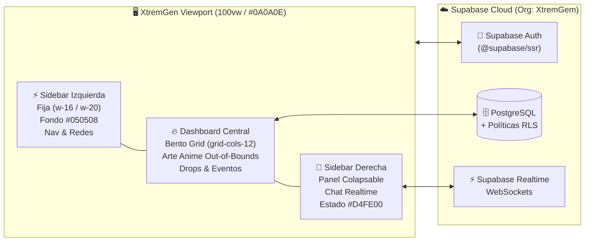

<div align="center">

# ⚡ XTREMGEN (XG) // ANIME-STREETWEAR REBEL HUB

**Comunidad interactiva, Drops exclusivos y Hub de cultura Anime-Streetwear con arquitectura inspirada en Opera GX.**

[](https://nextjs.org/)
[](https://react.dev/)
[](https://www.typescriptlang.org/)
[](https://tailwindcss.com/)
[](https://supabase.com/)
[](https://github.com/javierbrega/XtremGen/actions)
[](./LICENSE)

</div>

---

## 🎯 Visión del Proyecto

**XtremGen (XG)** fusiona la estética **Neobrutalista / Fanzine Urbano** con una experiencia de navegación de alto rendimiento estilo **Opera GX**. Diseñado para ofrecer un dashboard tipo **Bento Grid** donde el arte anime rompe los límites de sus contenedores (*out-of-bounds*), acompañado de un **Chat de la Comunidad en Tiempo Real** impulsado por **Supabase Realtime**.

---

## 🏛️ Arquitectura de Navegación (Opera GX Layout)



---

## 🎨 Identidad Visual & Sistema de Diseño

Todos los componentes cumplen estrictamente con los estándares definidos en [`gemini.md`](./gemini.md):

| Token Tailwind | Hex | Rol en la Interfaz |
| :--- | :--- | :--- |
| `bg-xg-bg` | `#0A0A0E` | **Negro Carbón Mate** — Fondo base principal del hub. |
| `bg-xg-contrast` | `#0B1020` | **Azul/Negro Profundo** — Tarjetas y contenedores de contraste. |
| `bg-xg-sidebar` | `#050508` | **Obsidiana GX** — Fondo ultra-oscuro para sidebars y paneles técnicos. |
| `text-xg-yellow` | `#FFD200` | **Amarillo Industrial / Street** — Acento primario y llamadas a la acción. |
| `text-xg-red` | `#E6002B` | **Rojo Sangre** — Acento agresivo, bordes de impacto y alertas. |
| `text-xg-neon` | `#D4FE00` | **Verde Neón** — Indicadores de estado *"SYSTEM ONLINE"* y actividad en vivo. |

### Reglas Geométricas y Tipográficas
* **Geometría de Cortes Secos**: Prohibido el uso de bordes muy redondeados; se utiliza exclusivamente `rounded-none` (`0px`) o `rounded-sm` (`2px`).
* **Sombreado Neobrutalista 2D**:
  * `shadow-brutal-black`: `4px 4px 0px 0px #000000`
  * `shadow-brutal-red`: `4px 4px 0px 0px #E6002B`
  * `shadow-brutal-yellow`: `4px 4px 0px 0px #FFD200`
* **Interacciones Glow**: `hover:shadow-glow-yellow` (`0 0 20px rgba(255, 210, 0, 0.45)`).
* **Tipografía**:
  * **Display / Títulos**: `Chakra Petch` (`font-display`)
  * **Cuerpo / UI**: `Space Grotesk` (`font-sans`)
  * **Datos Técnicos / Badges**: `JetBrains Mono` (`font-mono`)

---

## 📂 Estructura del Proyecto

```text
XtremGen/
├── .agents/                          # Customizaciones para Agentes IA (Antigravity)
│   ├── plugins/xtremgen-github/      # Plugin MCP de GitHub del proyecto
│   └── skills/
│       ├── github-workflow/          # Skill de flujo Git y Conventional Commits
│       └── xtremgen-supabase/        # Skill de arquitectura Supabase + RLS + Realtime
├── .github/                          # Workflows CI/CD, Dependabot y plantillas de Issues/PRs
├── src/
│   ├── app/
│   │   ├── globals.css               # Estilos base y scrollbars estilo Opera GX
│   │   ├── layout.tsx                # Configuración de fuentes y metadatos globales
│   │   └── page.tsx                  # Vista principal del Hub
│   └── lib/
│       └── utils.ts                  # Utilidad cn() (clsx + tailwind-merge)
├── gemini.md                         # Reglas de arquitectura y diseño (Always-On)
├── tailwind.config.ts                # Tokens de diseño XG
└── package.json
```

---

## 🚀 Instalación y Puesta en Marcha

### 1. Clonar el repositorio
```bash
git clone https://github.com/javierbrega/XtremGen.git
cd XtremGen
```

### 2. Instalar dependencias
```bash
npm install
```

### 3. Configurar variables de entorno
Copia el archivo de ejemplo `.env.example` a `.env.local` y completa tus credenciales públicas de Supabase:
```bash
cp .env.example .env.local
```

### 4. Iniciar el servidor de desarrollo
```bash
npm run dev
```
Abre [http://localhost:3000](http://localhost:3000) en tu navegador.

---

## 🗺️ Roadmap de Desarrollo (Issues Activos)

- [x] **Fase 0**: Inicialización de Next.js 15, TypeScript estricto, Tailwind CSS y tokens de identidad visual (`#FFD200`, `#E6002B`, `#0A0A0E`).
- [x] **Fase 1**: Configuración de ecosistema Agentic (Skills de GitHub y Supabase + Servidores MCP).
- [ ] **Fase 2.1**: [Sidebar Izquierda fija estilo Opera GX (`w-16`/`w-20`)](https://github.com/javierbrega/XtremGen/issues/1) (`#1`)
- [ ] **Fase 2.2**: [Dashboard Central — Bento Grid (`grid-cols-12`) con arte anime *out-of-bounds*](https://github.com/javierbrega/XtremGen/issues/2) (`#2`)
- [ ] **Fase 3**: [Sidebar Derecha Colapsable — UI del Chat de la Comunidad](https://github.com/javierbrega/XtremGen/issues/3) (`#3`)
- [ ] **Fase 4**: [Integración Backend con Supabase Auth, Database RLS & Realtime Chat](https://github.com/javierbrega/XtremGen/issues/4) (`#4`)

---

## 🤝 Contribución y Licencia

Las contribuciones son bienvenidas. Por favor revisa nuestra [Guía de Contribución](./CONTRIBUTING.md) y el [Código de Conducta](./CODE_OF_CONDUCT.md) antes de enviar un Pull Request.

Distribuido bajo la licencia **MIT**. Consulta el archivo [`LICENSE`](./LICENSE) para más detalles.

---

<div align="center">
  Desarrollado con ⚡ por <a href="https://github.com/javierbrega"><strong>Orlando Javier Brega</strong></a>
</div>
